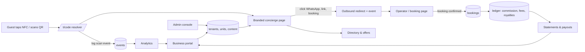

# TapIt – Research, Product Surfaces & System Workflow

## 1. What similar products do

| Product type | Examples | Patterns worth copying |
|---|---|---|
| Digital guidebooks / concierge | [Touch Stay](https://touchstay.com/features?hsLang=en), [Enso Connect](https://ensoconnect.com/blog/the-best-guestview-guide-alternative) | Per-property guide, AI helper, upsell widget, bulk updates across properties |
| Digital passports / stamp trails | [Bandwango case study](https://www.casestudies.com/company/bandwango/case-study/soin-tourism-gets-494-sign-ups-in-one-month-with-bandwango), [Seeker](https://explore.seeker.io/what-is-a-digital-passport) | Check-in challenges, badges, rewards, first-party data. (Vendor claims, unverified.) |
| SA payments | [PayFast Split Payments](https://payfast.io/?p=6563) | Split commission to a third party at payment time |
| Maps | [MapLibre terrain](https://maplibre.org/maplibre-gl-js/docs/examples/3d-terrain/) | Hillshade is cheap; real 3D needs a raster-DEM source and tilted camera |

Gaps in the research (confirm before committing): none of the guidebook tools were checked for NFC; Peach/Yoco/Ozow split-payout support is unconfirmed; hosted tile and DEM licensing costs are unknown.

## 2. Product surfaces

1. **Public landing (tapit.info)** – what TapIt is, for guests, for businesses, pilot sign-up. Static, fast, SEO.
2. **Guest app (/t/{code})** – branded concierge for one site. No login. Info, Wi-Fi, links, nearby, offers, map.
3. **Directory (/explore)** – browse businesses, trails, events; links back to the originating unit's attribution.
4. **Business portal (/portal)** – owner edits concierge content (CMS), listings, offers, sees analytics, statements.
5. **Admin console (/admin)** – TapIt staff: tenants, units, content moderation, billing, commissions, payouts, audit log.
6. **Adventure layer (phase 2)** – passport, stamps, 3D trail tracking.

### CMS / blog hybrid
Block-based editor (Tiptap or similar) storing structured JSON: fixed "smart sections" (Wi-Fi, check-out, contacts, house rules) plus free blocks (text, image, link, map pin, offer). Draft → preview-on-phone → publish, with version history. Blog/articles reuse the same editor for destination content.

## 3. Workflow

### Business logic rules
- Every unit maps to one tenant; every event carries `unit_id`, `tenant_id`, timestamp, anonymised session id.
- Attribution: a booking is credited to the unit of the session that produced the click (first-touch, 30-day window; to be agreed).
- Money lives in an **append-only double-entry ledger**. Never edit; reverse with a contra entry. Accounts: guest payments, operator payable, commission income, referrer/royalty payable, VAT.
- Commission = booking value × agreed rate on the operator–TapIt agreement; royalty splits are rules attached to the agreement.
- Subscriptions generate invoices on schedule; statements are monthly per business.
- MVP: payouts reviewed by an admin and paid by EFT; gateway split payments are a later automation.

## 4. Scope vs November

| In pilot (by end Nov) | Designed now, built later |
|---|---|
| Landing, guest concierge, CMS, admin, unit management, event analytics, POPIA consent/policy, CI/CD + hardening | Online booking and payments, payout automation, passport, 3D trails, business-portal analytics depth |
| Ledger/agreement schema in the database | Ledger UI beyond a basic admin view |

## 5. Risks to flag to the client
- **3D on tourists' phones** with weak rural signal: ship hillshade/2D first, load 3D only on request and good connection.
- **Holding guest money** creates regulatory and tax duties; start by invoicing commission rather than collecting funds.
- **POPIA**: anonymous analytics for pilot; consent required before any contact data, passport, or offers.
- **Security**: plan an external penetration test before opening to the public, with 2–3 weeks buffer.

## 6. Next
1. Client answers `01-client-questions.md` (★ items first).
2. Visual direction agreed (palette, tone, how much 3D).
3. Clickable mockups: landing, guest page, CMS editor, admin dashboard, ledger.

## 7. Trip replay & tracking (clarified scope)

**What is wanted:** 3D is not the whole UI. It is one feature: open a past trip and watch the route replay over 3D terrain (camera follows the hiker), plus recording the trip from the user's phone.

**Pilot (November):** "Featured trail flyover" on the guest page. Admin uploads a GPX; the page plays the 3D replay. Same viewer component as later user trips, no tracking or login needed.

**Phase 2:** user trips.
- Record: browser Geolocation `watchPosition` while the page is open, screen kept awake. Points buffered in IndexedDB and synced when signal returns.
- Import: GPX from Garmin/Strava/watches (more reliable than browser tracking).
- Replay: MapLibre raster-DEM terrain, pitched camera following the line, progress line, elevation profile scrubber, 2D/3D toggle.

**Constraints:**
- Web pages cannot track reliably in the background (iOS Safari especially). Reliable background tracking needs a native wrapper (Capacitor) – a later decision.
- Mountain signal is poor: record offline, sync later. Offline map tiles are a separate piece of work.
- Self-host tiles on the VPS as PMTiles (basemap + DEM) to avoid per-request fees. Satellite imagery licensing is the cost trap; avoid it.
- Location trails are personal information under POPIA (they can reveal where someone stays). Needs explicit opt-in, retention limits, delete-my-trips, and a "not a safety device" notice.
- Trips need an account: passwordless email login, created only when a user chooses to save a trip.

**Data model:** `trips`, `track_points` (PostGIS geometry + time + accuracy), `routes` (curated GPX), `stamps`. Postgres with PostGIS on the VPS.
